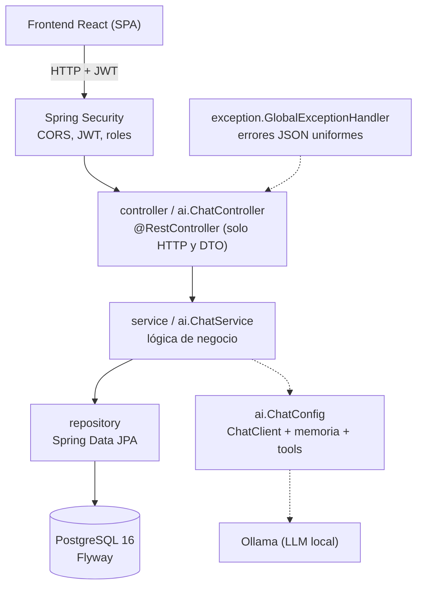
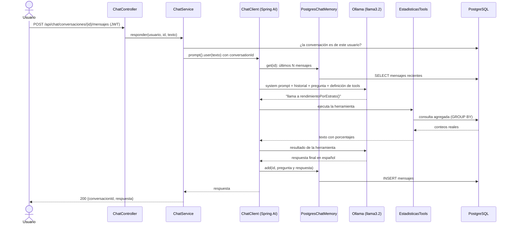

# Arquitectura

Aplicación MVC por capas con Spring Web MVC (servlet). El frontend (React, otro proyecto) consume una API REST JSON.

## Capas

| Paquete | Responsabilidad |
|---|---|
| `config` | Seguridad (`SecurityConfig`), propiedades (`JwtProperties`, `AdminProperties`), admin inicial. |
| `security` | Respuestas 401/403 en JSON. |
| `controller` | Endpoints REST de autenticación, administración, estadísticas y resultados. |
| `service` | Reglas de negocio: autenticación, JWT, estadísticas, listado de resultados. |
| `repository` | Acceso a datos (consultas JPQL agregadas, Specifications). |
| `model` | Entidades JPA y enumerados. |
| `dto` | Records de entrada y salida (separados de las entidades). |
| `exception` | `ApiException` y `@RestControllerAdvice`. |
| `ai` | Chatbot: `ChatConfig`, `ChatService`, `ChatController`, `PostgresChatMemory`, `EstadisticasTools`. |

## Seguridad

* Stateless: no hay sesión ni cookies; cada petición lleva `Authorization: Bearer <JWT>`.
* El login valida la contraseña (BCrypt) y emite un JWT firmado HS256 con `sub` = usuario y claim `rol`.
* `oauth2ResourceServer(jwt)` valida firma y expiración; el claim `rol` se convierte en `ROLE_USER` / `ROLE_ADMIN`.
* Reglas: `POST /api/auth/register` y `/login` y `/actuator/health` públicos; `/api/admin/**` solo ADMIN
  (además `@PreAuthorize`); todo lo demás requiere token.

## Flujo del chat

* **Memoria:** `PostgresChatMemory` guarda todo el historial pero solo entrega al modelo los últimos
  `app.chat.memory-window` mensajes (20 por defecto).
* **Tool calling:** el modelo no inventa cifras; invoca métodos `@Tool` que consultan la base.
* **Streaming:** `POST .../mensajes/stream` devuelve la misma respuesta por trozos con Server-Sent Events.
* **Errores:** si Ollama no responde, la API devuelve `503` en JSON con un mensaje claro.

## Diagramas interactivos

Versiones HTML (se abren en el navegador, con tema claro/oscuro):

* [Arquitectura de la aplicación](arquitectura-diagrama.html)
* [Flujo del chat (diagrama de secuencia)](flujo-chat-diagrama.html)
