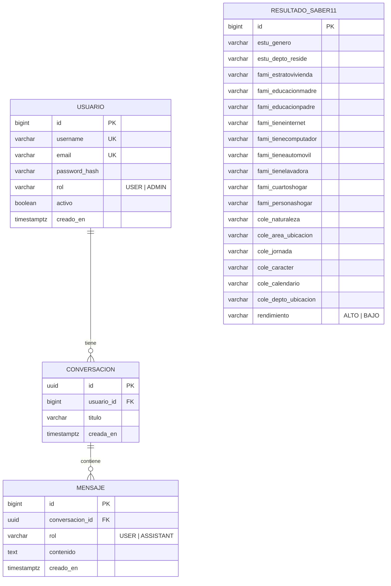

# Modelo de datos

Base de datos PostgreSQL 16. El esquema lo crea Flyway (`src/main/resources/db/migration/V1__esquema.sql`)
y Hibernate solo lo valida (`ddl-auto=validate`).

## Diagrama entidad-relación

`RESULTADO_SABER11` no tiene relaciones: es el conjunto de datos analítico (un registro por estudiante)
y es independiente de los usuarios y del chat.

## Diccionario de datos

### Tabla `usuario`

| Columna | Tipo | Nulo | Descripción |
|---|---|---|---|
| id | BIGSERIAL (PK) | No | Identificador autogenerado. |
| username | VARCHAR(50) UNIQUE | No | Nombre de usuario para iniciar sesión. |
| email | VARCHAR(150) UNIQUE | No | Correo electrónico (se guarda en minúsculas). |
| password_hash | VARCHAR(100) | No | Contraseña cifrada con BCrypt (nunca en texto plano). |
| rol | VARCHAR(10) | No | `USER` o `ADMIN` (restringido con CHECK). |
| activo | BOOLEAN | No | Si es `false`, el usuario no puede iniciar sesión. Por defecto `true`. |
| creado_en | TIMESTAMPTZ | No | Fecha de creación. |

### Tabla `conversacion`

| Columna | Tipo | Nulo | Descripción |
|---|---|---|---|
| id | UUID (PK) | No | Identificador de la conversación; también es el `conversationId` de Spring AI. |
| usuario_id | BIGINT (FK → usuario.id) | No | Dueño de la conversación. Se borra en cascada con el usuario. |
| titulo | VARCHAR(200) | No | Título; si no se indica, se usa el inicio de la primera pregunta. |
| creada_en | TIMESTAMPTZ | No | Fecha de creación. |

### Tabla `mensaje`

| Columna | Tipo | Nulo | Descripción |
|---|---|---|---|
| id | BIGSERIAL (PK) | No | Identificador; su orden define el orden de la conversación. |
| conversacion_id | UUID (FK → conversacion.id) | No | Conversación a la que pertenece. Borrado en cascada. |
| rol | VARCHAR(10) | No | Autor: `USER` (persona) o `ASSISTANT` (modelo). |
| contenido | TEXT | No | Texto del mensaje. |
| creado_en | TIMESTAMPTZ | No | Fecha y hora del mensaje. |

### Tabla `resultado_saber11`

Datos abiertos del ICFES (Saber 11, periodo 2022-4). Todas las columnas descriptivas son texto ya normalizado
(ASCII, sin tildes ni comas). La tabla se crea vacía; la carga se hace en una etapa posterior.

| Columna | Tipo | Nulo | Descripción |
|---|---|---|---|
| id | BIGSERIAL (PK) | No | Identificador interno. |
| estu_genero | VARCHAR(50) | Sí | Género del estudiante. |
| estu_depto_reside | VARCHAR(100) | Sí | Departamento donde reside el estudiante. |
| fami_estratovivienda | VARCHAR(50) | Sí | Estrato de la vivienda (Estrato 1 a 6, Sin Estratificar). |
| fami_educacionmadre | VARCHAR(100) | Sí | Nivel educativo de la madre. |
| fami_educacionpadre | VARCHAR(100) | Sí | Nivel educativo del padre. |
| fami_tieneinternet | VARCHAR(10) | Sí | El hogar tiene internet (SI/NO). |
| fami_tienecomputador | VARCHAR(10) | Sí | El hogar tiene computador (SI/NO). |
| fami_tieneautomovil | VARCHAR(10) | Sí | El hogar tiene automóvil (SI/NO). |
| fami_tienelavadora | VARCHAR(10) | Sí | El hogar tiene lavadora (SI/NO). |
| fami_cuartoshogar | VARCHAR(30) | Sí | Número de cuartos del hogar. |
| fami_personashogar | VARCHAR(30) | Sí | Número de personas del hogar. |
| cole_naturaleza | VARCHAR(30) | Sí | Naturaleza del colegio (oficial / no oficial). |
| cole_area_ubicacion | VARCHAR(30) | Sí | Área de ubicación del colegio (urbano / rural). |
| cole_jornada | VARCHAR(30) | Sí | Jornada del colegio (mañana, tarde, completa, noche, sabatina...). |
| cole_caracter | VARCHAR(50) | Sí | Carácter del colegio (académico, técnico, técnico/académico...). |
| cole_calendario | VARCHAR(10) | Sí | Calendario del colegio (A, B u otro). |
| cole_depto_ubicacion | VARCHAR(100) | Sí | Departamento donde está ubicado el colegio. |
| rendimiento | VARCHAR(10) | Sí | Clasificación del desempeño: `ALTO` o `BAJO` (CHECK). |

**Índices** (para las consultas que agrupan): `idx_resultado_estrato`, `idx_resultado_jornada`,
`idx_resultado_naturaleza`, `idx_resultado_depto_cole`, `idx_resultado_rendimiento`.
Además `idx_conversacion_usuario` y `idx_mensaje_conversacion (conversacion_id, id)`.
